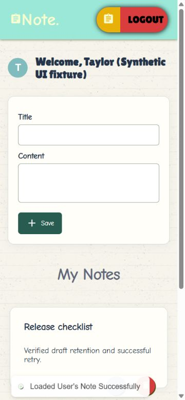

# Notes — frontend

Shivansh Verma's notes application, paired with NotepadAppBackend. The upgrade/notes-v1 branch retains the original React 18/MUI business logic with Vite build/dev tooling. Failed saves retain drafts, duplicate submissions are blocked, labels/pending/errors are accessible, deletion asks for confirmation and stable note IDs preserve component identity. Search titles and content in your loaded private library, with result counts, clear, loading/retry and empty/no-match states. Search stays in page memory and successful saves update the filtered results. This is an upgrade branch, not a verified hosted release.

## Setup and checks
Node 22.12+ (Node 22 line) or Node 24+, npm ci, npm start, then open http://localhost:3000. The source defaults to same-origin /notepad; for local separate ports set REACT_APP_API_URL=http://localhost:4040/notepad in ignored .env.local and run the paired backend. Signed cookies and the request header accompany API calls; session restoration finishes before notes redirect/fetch. See [local integration and paired deployment contract](docs/LOCAL_INTEGRATION.md) and [Vite configuration/static hosting](docs/TOOLCHAIN.md). Do not copy production credentials into frontend source.

npm test -- --watchAll=false --runInBand; npm run lint; npm run build; npm run test:toolchain. Latest local verification: fresh install, lint, all 30 behavior tests, production build and synthetic dev/build/preview contract checks passed. Full audit remains 19 moderate tool-only findings (zero high/critical); runtime-only audit is zero. Compatible upstream fixes for the Istanbul/YAML/formatting path are unavailable; see the decision record. Linter support and toolchain deprecation warnings remain; see docs/VERIFICATION.md for scope. Plain JavaScript has no typecheck command. Output stays in build/ with assets/ modules and a Netlify SPA fallback declaration. Configure the API proxy before the fallback; hosted behavior and browser flows remain unverified. No preview deployed.

## Product release and AI
The durable release criteria in BACKLOG.md cover correct private CRUD, a polished searchable notes workspace and one opt-in summary over authorized selected notes. AI is planned, not implemented or mocked as a live feature. Provider keys will stay server-side. No user counts, performance gains, live URL or hiring-impact metrics are claimed.

## Continuity and recovery
UPGRADE_LOG.md and docs/DECISIONS.md record changes/next tasks. Keep the original default branch recoverable; do not deploy over its existing site or migrate data without authorization. The paired backend docs/automation contains the recurring workflow's runner source. Screenshots capture synthetic local UI verification. Real temporary local MongoDB HTTP integration passed with synthetic accounts. The browser tool exposes no browser in this run; visual/cookie behavior for this auth slice and the hosted journey remain unverified.

